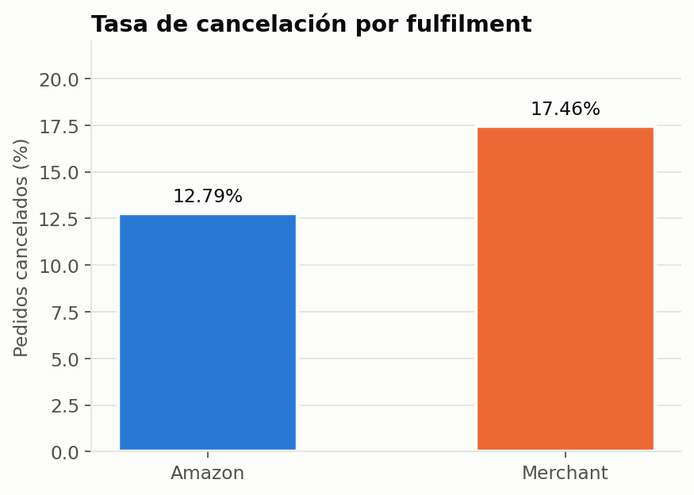
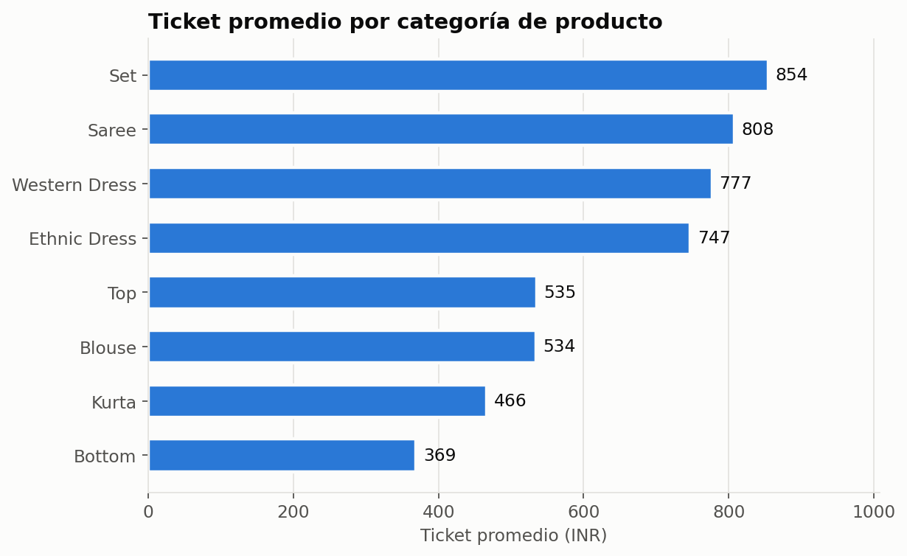
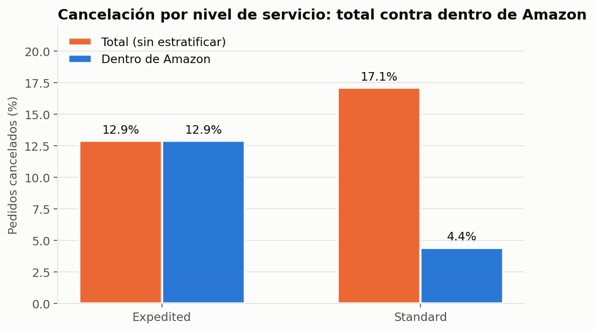
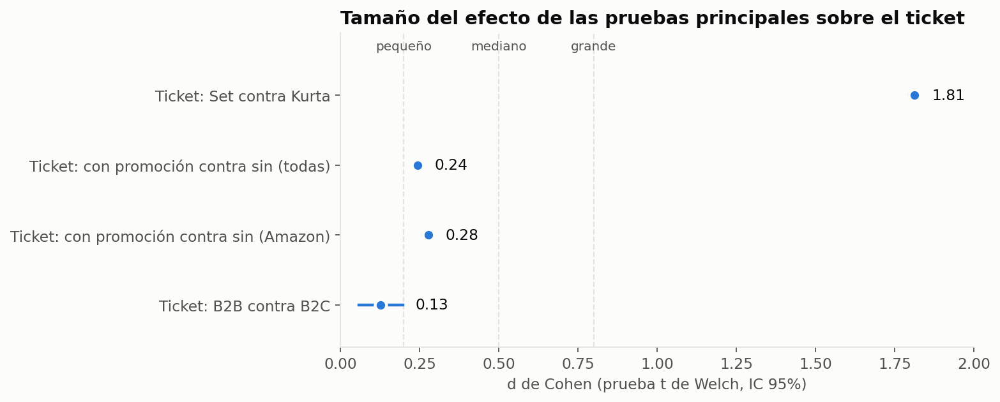

# ¿Qué factores operativos y comerciales están asociados con la cancelación de pedidos y con el valor del ticket en las ventas de Amazon India?

## Desafío
Con 128,975 líneas de pedido de Amazon India entre marzo y junio de 2022, no se sabía qué tan relevantes eran, en la práctica, factores como el tipo de fulfilment (Amazon o Merchant), el nivel de servicio de envío, las promociones, la categoría de producto o el tipo de cliente (B2B o B2C) para explicar la cancelación de pedidos y el ticket promedio, ni si algunas de esas relaciones aparentes eran en realidad artefactos del dataset o factores de confusión entre sí.

## Proceso
Limpié el dataset (duplicados, columnas basura, nulos con mecanismo MAR ligado a la cancelación, mes de marzo incompleto) y lo exploré con estadística descriptiva. Después puse a prueba seis hipótesis con chi cuadrado, ANOVA de Welch y pruebas t de Welch (las comparaciones de ticket, acompañadas de Mann-Whitney U o Kruskal-Wallis como robustez), prestando atención especial a dos problemas: la casi confusión entre fulfilment y nivel de servicio de envío, y el hecho de que las promociones se capturan casi solo cuando el pedido se envía.

## Resultado
El fulfilment es el factor más confiable sobre la cancelación: Merchant cancela 17.46% de sus pedidos contra 12.79% de Amazon, una diferencia de 4.67 puntos porcentuales. El nivel de servicio de envío, en cambio, está casi confundido con el fulfilment, y al estratificar dentro de Amazon la relación se invierte (paradoja de Simpson). Sobre el ticket, el factor con el efecto más grande, por mucho, es la categoría de producto: Set (854 INR en promedio) casi duplica el ticket de Kurta (466 INR), mientras que promociones, tipo de cliente, mes y día de la semana tienen efectos pequeños o nulos. Además, se documenta que la variable de promociones no se puede usar como predictor de la cancelación por un artefacto de captura del dataset.


# E-Commerce Sales Analysis

## Resumen

Análisis estadístico e inferencial del reporte de ventas de Amazon India (`Amazon Sale Report.csv`) entre el 31 de marzo y el 29 de junio de 2022, a nivel de línea de pedido (un SKU dentro de una orden). El objetivo fue identificar qué factores operativos (fulfilment, nivel de servicio de envío) y comerciales (promociones, categoría de producto, tipo de cliente B2B o B2C, estacionalidad) se asocian con la cancelación de pedidos y con el ticket promedio. Trabajé en fases: calidad de datos, limpieza, estadística descriptiva, pruebas de hipótesis y un cierre con insights y recomendaciones.

## Principales hallazgos

### 1. Merchant cancela más que Amazon



- La tasa de cancelación es de 12.79% en Amazon contra 17.46% en Merchant, una diferencia de 4.67 puntos porcentuales (IC 95% de 4.23 a 5.10).
- La asociación es significativa (chi cuadrado = 487.53, p = 4.91e-108), con un tamaño de efecto pequeño (V de Cramér = 0.0615), pero consistente en las cuatro celdas de la tabla de contingencia.

### 2. La categoría de producto es, por mucho, el factor con más peso sobre el ticket



- El ticket promedio va de 369 INR en Bottom a 854 INR en Set. La categoría explica el 44.8% de la variación del ticket (ANOVA de Welch, eta cuadrada = 0.4483, el efecto más grande de todo el análisis).
- Entre las dos categorías que dominan el volumen de ventas, Set (854 INR) casi duplica el ticket de Kurta (466 INR): diferencia de 388 INR, d de Cohen = 1.812 (efecto grande).

### 3. Fulfilment y nivel de servicio están casi confundidos, y la relación se invierte al estratificar



- Merchant es 100% Standard y Amazon es 98.79% Expedited, así que ambos factores se mueven casi juntos.
- Sin estratificar, Standard parece cancelar más que Expedited (17.1% contra 12.9%). Pero dentro de Amazon, donde sí hay variación en ambos niveles, la relación se invierte: Standard cancela menos (4.4% contra 12.9%), un caso claro de paradoja de Simpson. La mayor parte de la diferencia observada se explica por el fulfilment, no por el nivel de servicio en sí.

### 4. Con más de 100,000 líneas, el tamaño del efecto manda sobre el p valor



- Con un dataset de 128,798 líneas de pedido, casi cualquier diferencia resulta estadísticamente significativa, incluidas diferencias mínimas (mes, fin de semana, B2B).
- Comparado con el efecto grande de la categoría (Set contra Kurta, d = 1.812), los efectos de promoción sobre el ticket (d = 0.24 en general, d = 0.28 dentro de Amazon) y de ser B2B (d = 0.13) son pequeños.
- Las promociones no se asocian de forma confiable con la cancelación: `promotion_ids` se captura casi solo cuando el pedido se envía (98.4% de los pedidos cancelados no tiene promoción registrada), así que esa relación se documenta como un artefacto del dataset y no como un hallazgo de negocio.

## Contenido del repositorio

- `notebooks/notebook.ipynb`: notebook principal con todo el análisis.
- `data/raw/`: archivos originales, tal como se descargan de Kaggle (el análisis usa únicamente `Amazon Sale Report.csv`).
- `data/clean/amazon_sales_clean.csv`: dataset limpio, generado en el Paso 3 del notebook.
- `figures/`: gráficas de este README.
- `py/libraries.py`: script que descarga el dataset desde Kaggle con `kagglehub` y lo copia a `data/raw`.
- `py/generar_figuras.py`: script que genera las gráficas de `figures/` a partir del dataset limpio.
- `requirements.txt`: dependencias necesarias para ejecutar el análisis.
- `LICENSE`: licencia del proyecto (MIT).

## Resumen de trabajo realizado

- **Paso 1, Carga de datos:** se cargó el dataset (128,975 filas, 24 columnas) y se revisó su estructura general.
- **Paso 2, Calidad de datos:**
	- 6 filas completamente duplicadas; `Order ID` se repite en 8,597 filas por diseño (un pedido puede tener varias líneas de SKU).
	- Nulos relevantes en `fulfilled-by` (69.55%, redundante con `Fulfilment`), `promotion-ids` (38.11%), `Unnamed: 22` (38.03%, columna basura), `Courier Status` (5.33%) y `currency`/`Amount` (6.04% cada una).
	- Los nulos de `Amount` y `Courier Status` dependen de si el pedido fue cancelado (mecanismo MAR): 41.27% de los pedidos Cancelled tienen `Amount` nulo, contra menos de 0.3% en el resto de los estatus.
	- Columnas basura o constantes (`Unnamed: 22`, `currency`, `ship-country`), columna redundante (`fulfilled-by`) e inconsistencias de formato en `Category` y `ship-state`. El 31 de marzo se identificó como un mes incompleto (171 filas).
- **Paso 3, Limpieza básica:**
	- Se eliminaron columnas sin valor analítico y las filas duplicadas, se renombraron columnas a snake_case, se parseó `date` y se excluyó el 31 de marzo.
	- Se normalizaron `ship_state`, `ship_city` y `category`, y se rellenaron con `'Sin dato'` los nulos de ubicación y `courier_status`. `amount` se dejó sin imputar.
	- Se crearon ocho variables nuevas, entre ellas `cancelado`, `tiene_promocion` y `venta_valida` (pedidos no cancelados, con monto positivo), usada para todo el análisis de ticket. El dataset limpio quedó en 128,798 líneas de pedido (120,220 pedidos únicos).
- **Paso 4, Estadística descriptiva:**
	- KPIs generales: ventas totales de 71,575,949 INR, ticket promedio de 663.26 INR, tasa de cancelación global de 14.22% y 61.89% de líneas con al menos una promoción.
	- Distribución del ticket con sesgo a la derecha y 3,492 outliers (3.24%) según el método IQR, conservados por ser precios reales de producto.
	- Se identificó la casi confusión entre `fulfilment` y `ship_service_level`, y el patrón de captura de `promotion_ids` ligado al resultado del pedido, ambos tratados con cuidado en el Paso 5.
- **Paso 5, Pruebas de hipótesis** (alfa = 0.05):
	- Seis hipótesis sobre fulfilment, promociones, categoría de producto, nivel de servicio, tiempo (mes y fin de semana) y tipo de cliente (B2B/B2C), usando chi cuadrado con V de Cramér, ANOVA de Welch con eta cuadrada y prueba t de Welch con d de Cohen. Las comparaciones de ticket se acompañaron de su versión no paramétrica (Mann-Whitney U o Kruskal-Wallis) como robustez.
	- Se estratificó por fulfilment para separar el efecto del nivel de servicio y el de las promociones, y se documentó el artefacto de `promotion_ids` como no interpretable para explicar la cancelación.
- **Paso 6, Insight ejecutivo:** síntesis de hallazgos, recomendaciones y limitaciones.

## Recomendaciones

- Investigar y atender el proceso de fulfilment de Merchant, cuya tasa de cancelación (17.46%) es consistentemente más alta que la de Amazon (12.79%).
- No usar el nivel de servicio de envío como palanca aislada para reducir cancelaciones: su efecto es casi nulo una vez separado del fulfilment, y el patrón se invierte según se estratifique o no.
- Priorizar el crecimiento de la categoría Set en la mezcla de producto y explorar estrategias de upselling de Kurta hacia productos tipo Set, dado el efecto grande de la categoría sobre el ticket.
- Corregir el proceso de captura de `promotion_ids` para que se registre desde la creación del pedido, y no solo cuando se despacha, de forma que en el futuro sí se pueda medir el efecto real de las promociones sobre la cancelación.
- No tratar promoción, mes, día de la semana o segmento B2B/B2C como palancas prioritarias para mover el ticket promedio: sus efectos son pequeños o nulos frente al de la categoría de producto.

## Limitaciones

- Es un estudio observacional: los resultados muestran asociación, no causalidad.
- El periodo cubierto es corto: solo tres meses completos (abril a junio de 2022).
- El análisis se limitó a `Amazon Sale Report.csv`; los demás archivos de `data/raw/` no se usaron por tener estructura y periodos distintos (inventario, gastos, ventas internacionales, estados de resultados).
- `promotion_ids` se captura después de conocerse el resultado del pedido, lo que impide usar este dataset para evaluar si las promociones influyen en la cancelación.
- Los grupos Standard dentro de Amazon (1,083 líneas) y B2B (797 líneas válidas) son chicos frente al resto de la muestra, así que sus resultados deben tomarse con cautela.
- Todas las pruebas evalúan un factor a la vez. Como siguiente paso, se sugiere un modelo multivariado (regresión logística para la cancelación, regresión lineal para el ticket) que controle simultáneamente por fulfilment, categoría, promoción, tipo de cliente y mes.

## Cómo reproducir el análisis

1. Requisitos mínimos
	- Python 3.11 o superior
	- Jupyter Notebook o Jupyter Lab

2. Instalar dependencias (ejecutar en terminal, desde la raíz del proyecto)

```powershell
python -m pip install -r requirements.txt
```

3. Descargar el dataset (opcional, ya está incluido en `data/raw`). El script usa rutas relativas, por lo que se ejecuta desde la carpeta `py/`

```powershell
cd py
python libraries.py
cd ..
```

4. Ejecutar el notebook

```powershell
jupyter notebook notebooks/notebook.ipynb
```

5. Regenerar las gráficas del README (opcional, requiere haber ejecutado el notebook para tener el dataset limpio)

```powershell
cd py
python generar_figuras.py
cd ..
```

## Fuente de datos

Dataset público de Kaggle: [thedevastator/unlock-profits-with-e-commerce-sales-data](https://www.kaggle.com/datasets/thedevastator/unlock-profits-with-e-commerce-sales-data).
